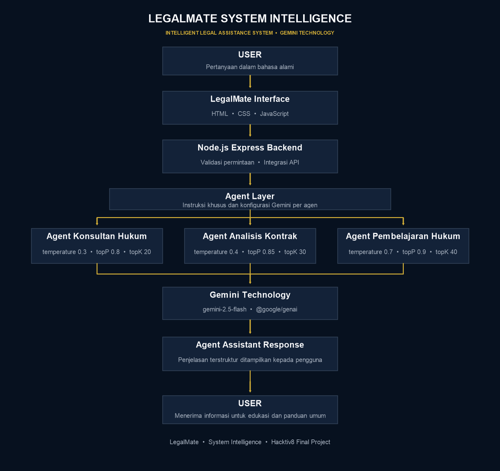

# ⚖️ LegalMate System Intelligence

### Intelligent Legal Assistance System Powered by Gemini Technology

[](https://nodejs.org/)
[](https://ai.google.dev/gemini-api)
[](#project-overview)
[](./LICENSE)

**LegalMate** is a domain-specific legal information and education system. It combines a focused legal workspace with three specialized Agent Assistants powered by Gemini Technology.

## Creator

**George Yesayas, S.Kom., S.H.**  
*System Intelligence Developer*  
Full-Stack Developer | Legal Technology Enthusiast

## Project Overview

LegalMate helps users get started with legal questions that can otherwise feel difficult to approach: understanding a general legal concept, reviewing contract wording, or learning a legal principle. The system was chosen as a practical legal technology use case because legal language is often dense and finding an accessible first explanation can be challenging.

Users ask in natural language and choose an Agent Assistant that fits their goal. System Intelligence applies the selected agent's instructions and Gemini generation parameters to produce a structured explanation in Indonesian by default. The application is designed to support understanding and further research—not to decide a legal matter.

## Use Case: Legal Assistance System

LegalMate supports three complementary activities:

- **Legal information support:** Explore general legal topics and principles.
- **Contract analysis assistance:** Understand clause wording, obligations, and possible areas of risk.
- **Legal learning assistance:** Learn legal concepts through clear explanations and examples.

Typical flow: select an Agent Assistant, submit a question, and review its response as an educational starting point.

## Features

- **Multi Agent Assistant Architecture** with distinct specialist roles.
- **Gemini Technology Integration** using the `gemini-2.5-flash` model through `@google/genai`.
- **System Instruction** for professional, structured, jurisdiction-aware responses that explain limitations.
- **Configurable model parameters** (`temperature`, `topP`, and `topK`) for each agent.
- **Premium legal dashboard interface** with responsive layout, visible active-agent configuration, suggested questions, timestamps, and processing feedback.
- Input validation and structured API errors; Gemini credentials remain in the backend environment.

## Agent Assistants

| Agent Assistant | Purpose | Temperature | Top P | Top K | Response characteristics |
| --- | --- | ---: | ---: | ---: | --- |
| **Agent Konsultan Hukum** | General legal information assistance. | 0.3 | 0.8 | 20 | Precise, structured explanations of general principles; notes when jurisdiction-specific context matters. |
| **Agent Analisis Kontrak** | Contract clause understanding and risk explanation. | 0.4 | 0.85 | 30 | Plain-language clause summaries, obligations, and potential risk areas to review. |
| **Agent Pembelajaran Hukum** | Legal education and concept explanation. | 0.7 | 0.9 | 40 | Accessible teaching, broken into key ideas and examples when useful. |

Each agent has a dedicated instruction and model configuration in `backend/agents.js`. A shared System Instruction in `backend/config.js` guides language, tone, structure, uncertainty, and legal limitations.

## Architecture



The browser interface is served by the Express backend. The backend validates the selected agent and question, combines shared and agent-specific instructions, and sends the request to Gemini Technology. The resulting Agent Assistant response is returned to the interface.

## Technology Stack

| Layer | Technology |
| --- | --- |
| Frontend | HTML, CSS, JavaScript |
| Backend | Node.js, Express.js |
| Model | Gemini Technology (`gemini-2.5-flash`, `@google/genai`) |
| Configuration | dotenv |

The application uses its existing vanilla JavaScript frontend and Node.js backend; no frontend framework or build step is required.

## Installation Guide

### Requirements

- Git
- Node.js 20 or later and npm
- A Gemini API key for live Agent Assistant responses

### Clone and install

Replace `<repository-url>` with the URL of your GitHub repository:

```bash
git clone <repository-url>
cd LegalMate-System-Intelligence
cd backend
npm install
```

### Configure the environment

Create `backend/.env` from the example, then add your Gemini API key:

**PowerShell**

```powershell
Copy-Item .env.example .env
```

**macOS / Linux**

```bash
cp .env.example .env
```

Set the values in `backend/.env`:

```env
GEMINI_API_KEY=your_gemini_api_key
PORT=3000
```

Keep `.env` private; it is excluded by `.gitignore`. The example file `backend/.env.example` is safe to commit.

### Start the application

From the `backend/` directory:

```bash
npm start
```

Open [http://localhost:3000](http://localhost:3000). The basic service check is available at [http://localhost:3000/api/health](http://localhost:3000/api/health). Stop the server with `Ctrl+C`.

## Screenshots

The `screenshots/` directory contains the architecture diagram and a guide for capturing the application. Add real application screenshots after running the project with a configured Gemini API key:

| File | Suggested capture |
| --- | --- |
| `screenshots/landing-page.png` | Landing page and welcome message |
| `screenshots/consultant-agent.png` | Agent Konsultan Hukum conversation |
| `screenshots/contract-agent.png` | Agent Analisis Kontrak conversation |
| `screenshots/learning-agent.png` | Agent Pembelajaran Hukum conversation |

Use non-sensitive sample questions. Never include API keys, personal information, or private contract text in screenshots.

## Repository Structure

```text
LegalMate-System-Intelligence/
├── .gitignore
├── LICENSE
├── README.md
├── backend/
│   ├── .env.example
│   ├── agents.js
│   ├── config.js
│   ├── index.js
│   ├── package-lock.json
│   └── package.json
├── public/
│   ├── index.html
│   ├── script.js
│   └── style.css
└── screenshots/
    ├── architecture.png
    ├── consultant-agent.placeholder.md
    ├── contract-agent.placeholder.md
    ├── landing-page.placeholder.md
    ├── learning-agent.placeholder.md
    └── README.md
```

## Disclaimer

LegalMate System Intelligence provides general legal information and educational assistance only. It does not provide a final legal decision or formal legal opinion and does not replace professional legal consultation. Laws and procedures vary by jurisdiction and context; consult a qualified legal professional about a specific matter.

## License

This project is distributed under the [MIT License](./LICENSE). Copyright © 2026 George Yesayas, S.Kom., S.H.
